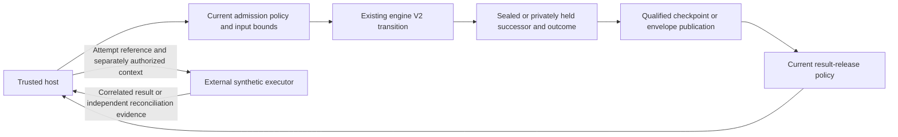

# Chronos domain model

Status: normative model for the declared v0.2 coordination profile and retained
v0.1 compatibility surface. External integration objects and alternative
profiles remain separately versioned and unclaimed.

## Owned objects

- **Engine:** the sole task-state publication authority.
- **Task:** admitted intent, policy inputs, dependencies, and lifecycle state.
- **Attempt:** one execution opportunity with a non-reused opaque identity.
- **Lease:** time-bounded authority for one attempt; cloning transfers the same
  authority and expiry never renews implicitly.
- **Agent assertion:** host-supplied identity and capabilities presented for
  bounded validation after external authentication.
- **Capability grant:** opaque, expiring, engine-scoped claim authority capturing
  one validated assertion and one revocable epoch. It is never persisted.
- **Observation:** bounded non-authoritative operational evidence.
- **Command journal:** bounded engine owner and pending audit outbox. It assigns
  `(scope, sequence)` record identity, backpressures before mutation, and releases
  only a host-acknowledged durable prefix; process memory itself is not audit
  durability.
- **Checkpoint:** canonical versioned recovery bytes with an optimistic
  predecessor/revision pair; storage and truthful durability acknowledgment are
  adapter responsibilities.
- **Checkpoint store register:** bounded optional `(revision, bytes)` state whose
  only publication is an exact predecessor compare-and-swap. Loads return owned
  bytes; the volatile reference register makes process loss explicit. The
  trusted-directory interpreter retains a bounded latest pair and separates
  known-uncommitted failures from post-publication uncertainty. Verified recovery
  requires storage and payload revisions to agree.

## Task lifecycle

```text
Blocked --dependencies succeed--> Ready --claim--> Running
                                     ^                |
                                     | known failure  | complete
                                     +----------------+--------> Succeeded
                                                      |
                                                      +--------> Failed

Running --expiry without safe retry--> Uncertain
Uncertain --completed evidence--> Succeeded
Uncertain --failed evidence--> Ready or Failed

Blocked, Ready, Running --cancel--> Cancelled
Blocked --dependency Failed/Cancelled--> Cancelled
```

At the exact expiry instant a lease is invalid. Expired running state may remain
physically present until expiry processing or the next claim, but cannot authorize
completion. A new claim creates a new attempt and lease; the old lease remains
invalid even when the same agent receives the retry.
Expiry is not failure evidence. A task with remaining attempts may return to
ready only when it carries a bounded admitted idempotency key whose scope the
connector enforces. Otherwise expiry enters `Uncertain` and requires explicit
completed/failed evidence. Unknown or conflicting evidence preserves the fence.

## Current scheduling profile

Eligible tasks are ready, below their attempt ceiling, and require a subset of
the capabilities captured by the current grant. Higher integer priority wins; task ID ascending
is the deterministic tie-breaker. `Best<ScheduleKey>` makes selection a
commutative idempotent fold with an empty identity. The profile is explicitly
`StrictPriorityV1` and does not guarantee fairness.

## Invariants

1. One task has at most one current running claim.
2. One lease belongs to exactly one engine namespace and attempt sequence.
3. Only the matching unexpired lease can mutate running state.
4. Attempts increase monotonically and never exceed the admitted ceiling.
5. Succeeded, failed, and cancelled states are terminal.
6. Ready implies all declared dependencies succeeded.
7. Refusal leaves the requested domain transition unapplied.
8. Observation state cannot influence domain state.
9. Resource accounting never wraps or silently exceeds configured limits.
10. Terminal attempt/task outcomes enter a bounded oldest-first retention window;
    saturation evicts the oldest record and cannot refuse the transition.
11. A blocked task with a terminally failed or cancelled dependency becomes
    cancelled and propagates that impossibility to its descendants.
12. Uncertain tasks are not schedulable; only completed or failed effect
    knowledge can resolve them. Conflict never grants transition authority.
13. Identity exhaustion refuses before compound claim housekeeping, so a refused
    claim cannot release or otherwise mutate expired work.
14. Domain `Debug` output is content-free; content access requires an explicit
    typed field or checkpoint-byte operation.
15. Only a current, unexpired grant from the same engine namespace can create a
    claim. Invalid grants refuse before housekeeping.
16. Revocation advances a monotone epoch and invalidates earlier grants for new
    claims; it does not retroactively alter independent lease authority.
17. Store conflict, size, or allocation refusal preserves the previously
    committed register; acknowledgment strength never exceeds adapter evidence.
18. A loaded checkpoint cannot recover through the verified path when its
    storage-attributed revision differs from its canonical payload revision.
19. A journal-owned command cannot execute without funded record capacity and a
    fresh sequence; acknowledged prefixes advance monotonically and cannot be
    re-acknowledged or skip beyond issued records.

## Algebraic interpretation

Within one behavioral profile, well-formed states and total command transitions
form the engine's composition domain. Refusal preserves the input state. Sequential
transitions compose without escaping the well-formed state space, and the unchanged
transition is identity. Profile migration is a separate explicit mapping.

Evidence accumulation uses closed bounded lattices only when the domain admits
honest join and meet operations. `EffectKnowledge` orders no evidence below the
incomparable failed/completed observations and contradictory evidence above them.
Conflict grants no authority. See the [operating rigor](docs/operating-rigor.md).

Bounded plans use ordered word composition with explicit overflow/capacity values.
Engine behavior is viewed coalgebraically through pure observations and explicit
transitions. Production cofree history is deferred until bounded retention and
continuation ownership exist. See the
[algebraic architecture](docs/algebraic-architecture.md).

The retained-outcome window is not a cofree history or durable audit log. It is a
bounded FIFO observation of accepted endings, with a closed disposition
vocabulary and explicit cumulative eviction count.

Checkpoint recovery creates a fresh authority namespace. Persisted running
attempts become uncertain and append a recovery-unknown outcome; lease authority
and grant authority are never serialized or resurrected. The persisted next-attempt sequence prevents
logical identity reuse within the recovered lineage.

Closed finite requirement profiles use powerset union/intersection/complement.
Resource usage composes component-wise and is ordered against the profile limit;
its residual is defined only when discharge is finite and nonnegative.

The production structure is not the reference model. The independent model in
`tests/state_machine_behavior.rs` deliberately uses a smaller representation.

## V2 lifecycle and observation state

An admitted task has `(TaskId, TaskIncarnation)`. `TaskId` is caller-chosen and
descriptive; `TaskIncarnation` is engine-issued from a persisted monotone
high-water mark. Dependencies may refer only to active IDs, so retirement is
defined exactly when the referenced incarnation is terminal and its reverse
dependency set is empty. Retirement removes the active object but not the
high-water fact. Re-admission of the same ID therefore produces a strictly newer
reference.

Authoritative task transitions advance `StateRevision` in the chain
`Finite(0) < ... < Exhausted`. Join is maximum and meet is minimum. Exact item
observations and lexical pages pair their coalgebraic projection with that
revision. A page continuation is valid only at the same revision; conditional
mutations are the partial action of an exact finite revision and refuse at top.
Temporal task mutations also refuse at top, so saturation cannot publish an
unobservable successor. Time and bounded grant administration remain available.

The monotone time state is `(optional floor, sequence)`. Advancing below the
floor is undefined as a transition and returns typed refusal. Advancing at or
above the floor issues a new opaque observation and invalidates the previous
sequence. Temporal V2 commands require equality with that current observation.
Recovery preserves the value state but changes the authority namespace, so old
observations cannot act.

Grant tokens are immutable witnesses into bounded engine-owned grant state.
Claim budgets decrease only with published claims. Selective/global revocation
and the monotone-time expiry sweep remove retained grant state, while leases
already published remain independent.

V2 command syntax is a finite coproduct distinct from V1. Its interpreter is a
Mealy coalgebra over engine state and typed outcome. `PreparedTransitionV2`
temporarily owns that successor and exposes only its checkpoint projection; a
validated acknowledgement releases the successor and outcome. `AuditRecordV2`
is a separate bounded observation of command kind and semantic disposition, not
part of authoritative task state.

`TaskSpecV2` is the minimized admission algebra: identifiers, graph edges,
scheduling capabilities, priority, attempt ceiling, and a closed retry-safety
class. Work content and raw connector keys are intentionally not members.
Detailed failures project into the closed scheduler class before admission.

The bounded exhaustive V2 abstraction in
`engine/chronos-engine/tests/exhaustive_coordination_model.rs` is independent of this production
representation and explores incarnation reuse attempts, retirement, uncertainty,
time, grant budgets, and revocation.

## Trusted native worker mediation (C4/R3)

The worker profile is a closed thirteen-variant sublanguage of existing engine
V2 commands, not a new task FSM or scheduler. One service engine owner interprets
coordination and worker commands. Native capabilities stay inside the trusted
host; executor attempt references are correlation only.



Volatile interpretation omits the storage boundary and makes no durable claim.
Checkpoint interpretation uses `PreparedTransitionV2`; envelope interpretation
holds authority privately until its existing strong receipt validates. Failure
drops held authority and fences the service. Recovery preserves attempt facts,
replaces grant/lease/time authority, and fences in-flight effects as uncertain.
Result withholding is not admission denial or permission to retry. Native worker
outcomes are not inserted into the coordination invocation replay FIFO.

Instrumentation sits at admission, engine preparation, publication and release;
per-operation residence and bounded resource/phase gauges are passive host
observations. No telemetry or executor callback enters the pure engine. The
existing engine algebra/finite models are unchanged; native lifecycle, receipt,
process-loss and instrumentation tests qualify this interpreter boundary, not
an arbitrary-history proof or distributed/external-effect exactly-once theorem.

## Selected scheduling controls and fixed concurrency profile

The native opt-in profile composes existing task/lease transitions with finite
eligibility controls and a bounded attempt-reservation set. Global or per-task
pause prevents new claims; `not_before` compares against caller-supplied time.
Neither changes lease renewal, completion, expiry or external process state.
Control commands use exact state revisions and task-incarnation guards. Enabling
the profile selects checkpoint V3; default engines still emit V2 and retain V1
decoding. The in-flight source profile now has a separate opt-in V5 scheduling
projection through embedded/private Unix clients. Its closed vocabulary exposes
observations and guarded controls, with no worker or quiescence-attestation verb.
Legacy local storage refuses this profile; atomic state is selected explicitly.

A configured positive capacity bounds the reservation set. Each successful claim
adds its exact task-incarnation/attempt reference before publication. Saturation
refuses before consuming a grant claim or attempt identity. Cancellation, expiry,
effect completion, retirement and process recovery do not remove reservations.
An authorized host must separately confirm execution quiescence, after the lease
is no longer running, before a reservation is released. An unknown effect can
remain unresolved after its stopped execution releases capacity. These facts
must never be collapsed into one task-state boolean.

Reservations survive retirement/name reuse and are inspectable through bounded
revision-consistent native pages. First activation of concurrency refuses engines
with historical attempts; it does not invent their quiescence or silently migrate
them. Native service admission, engine, publication and result release retain
separate content-free counters/timing samples. Existing physical storage/host
evidence premises apply; there is no CPU/RSS isolation or arbitrary-history proof.
The standalone's ordinary write policy explicitly refuses quiescence. Only a
trusted native host with independent executor-stop evidence can release capacity.
Service stage signals flow through RuntimeSignals. The MCP scheduling tool and
shared human-client model now consume this projection outside the engine. The
model separates observation, proposal and one-time confirmation, rejects mixed
revision reads and discards plans on selection/view changes. Both use bounded
content-free interface measurements; transport waits stay on the UI worker.
The terminal/macOS components now opt into this workflow independently, retaining
forms and gestures at their presentation edges. Headless journeys exercise the
same service and a private-process terminal snapshot qualifies actual transport.
The new macOS controls remain visually unqualified; no desktop was opened.

## Text continuity at the document/integration boundary

Readable work intent/context remains in ordinary text owned by the document or
integration layer. Chronos retains finite coordination state; its checkpoint and
the native capture journal are not substitutes for a work document. Org-style
headings, stable item IDs, local properties, links and notes are useful precedents;
Org/Markdown syntax adapters remain outside the engine. Existing source format is
preserved; no canonical file syntax or automatic format conversion is selected.

An offline human/agent can read context and record progress in independent tools.
The text carries explicit last-observed coordination facts separately from
authored changes. Reconnection compares source versions and exact service/task
incarnations, then presents bounded permitted changes or conflicts. A checkmark,
old RUNNING label or copied attempt ID cannot restore lease authority, certify an
external effect, or release capacity. The handoff has to remain understandable
without resolving opaque application-only identities.

The separate Vellum capture integration now implements bounded lossless export,
readable work context, a three-way offline source review and exact service/task
incarnation checks. Its synthetic file example works after both engine owners
are dropped. Full-source disclosure has its own current authority gate; proposals
carry the current source version and cannot execute a coordination command.
Content-free counters/gauges and a bounded residence histogram observe this edge.
The separate bounded handoff carrier retains exact baseline/card and observed
correlation across process exit. Reloaded metadata is explicitly unverified even
when identifiers/revisions match; strict parsing is not provenance or authority.
Readable source and card remain independently usable. The macOS integration
publishes the complete staged handoff at one exclusive final directory name
under a host-authorized private local parent. The host confirms a guarded
source proposal through Vellum's current edit contract. Offline checkmarks
remain authored progress rather than coordination mutations.
